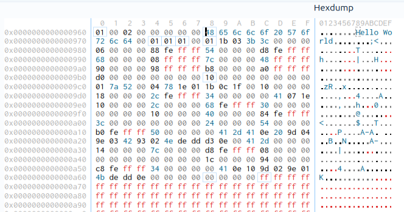
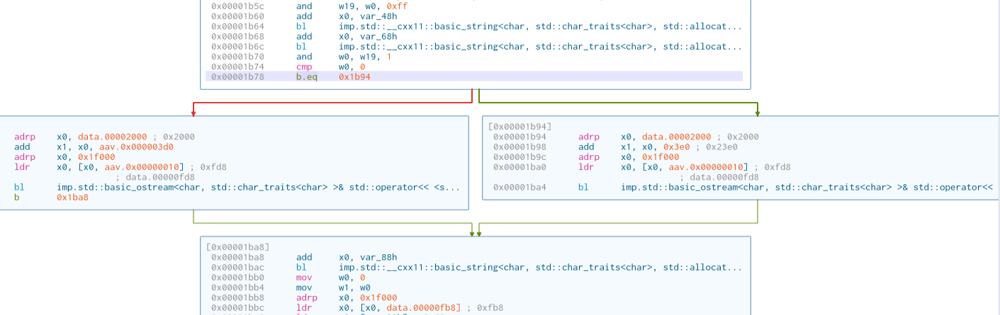

# Introduction

In this lab you will use Cutter to view and manipulate assembly to get the desired output from compiled code. It is recommended that you do this lab on your virtual machine. The files needed for this lab are located on Canvas as `cutter-lab-executables.zip`.

# Download and Install Cutter

Follow the appropriate set of instructions to install Cutter on your Virtual Machine. 

## x86-64

If your machine has an x86-64 architecture (ex: host machine is Windows), follow these instructions:

1. Go to [https://cutter.re](https://cutter.re) and click download.

:::{.callout-tip}
# Troubleshooting Tip

If you are using Firefox and have trouble visiting the download page, or if the download page doesn't autodetect that you're using Linux, install Chrome and try again.
:::

2. Once downloaded, you will have a .AppImage file. Move this file to a location that you will remember it, perhaps a folder for this course.

3. Make the .AppImage file executable 

```sh
chmod +x [filename].AppImage
```

4. Make sure you can open the file by either running it as an executable in the terminal or double clicking on it.

## arm64

If your machine has arm64 architecture (ex: host machine is an M-series Mac), you will need to build from source to install on your Virtual Machine. 

1. Follow the instructions found here [https://cutter.re/docs/building.html](https://cutter.re/docs/building.html). 

2. Move the file named `cutter` that was created in ./build to a convenient location, perhaps a folder for this course.

3. Make the file executable.

```sh
chmod +x cutter 
``` 

# File Manipulation

Download the `cutter-lab-executables.zip` from Canvas onto your VM. When you unzip this file, you should find multiple folders inside indicating the architecture and OS for the machine that compiled the files. Note that the source code used to create these files is identical. When running the files, you should use the ones that correspond to your Virtual Machine's architecture.

Use the table below to find the folder that matches your setup. If you are not sure of your VM's architecture, run `uname -m` in its terminal: `x86_64` means x86-64 and `aarch64` means arm64.

| Host Machine | Virtual Machine | Folder |
|---|---|---|
| Windows PC (Intel/AMD) | Linux (x86-64) | `x86-64-ubuntu` or `x86-64-mint` |
| Intel Mac | Linux (x86-64) | `x86-64-ubuntu` or `x86-64-mint` |
| M-series Mac | Linux (arm64) | `arm64-ubuntu` |
| M-series Mac | None (running Cutter on macOS) | `arm64-mac` |
| M-series Mac | Windows 11 (arm) | `arm-win11` |
| Windows on ARM (ex: Snapdragon laptop) | Linux (arm64) | `arm64-ubuntu` |
| Windows on ARM (ex: Snapdragon laptop) | None (running Cutter on Windows) | `arm-win11` |

: Choosing the correct folder of executables {#tbl-folders}

:::{.callout-note}
The two x86-64 Linux folders both work on any recent x86-64 Linux distribution. They differ only in the compiler version used, so the assembly may look slightly different. The `arm-win11` executables were compiled on an arm machine but contain x86-64 instructions, which Windows runs through emulation. If you use them, follow the x86 instructions in this lab.
:::

## File 1.exe

For file 1, our goal is to become familiar with various parts of the Cutter interface by modifying the output of the executable without the source code.

1. Before opening Cutter, execute `1.exe` to see what it does. Note that you may need to make it executable before running it using `chmod +x 1.exe`. Once you have run it, you should see that it simply prints out `Hello World`.

2. Now open Cutter and select `1.exe` as the file you want to work with using the `Select` button. Click Open once it has been selected. 

3. After clicking Open, a window named `Load Options` will appear. You can leave the defaults and just click `Ok`. 

4. Once you've opened the file, find the `Graph` tab at the bottom of the screen and select it.

5. Double click on `main` in the left navigation to view the assembly code associated with the main function. 

6. At this point, if viewing the x86-64 version of `1.exe`, you should see some commands that are similar to those mentioned in class. If viewing the arm64 version of `1.exe`, they will look slightly different although you can probably guess the equivalent instructions for x86 for most of them.

7. Find `str.Hello_World` inside the assembly code while the Graph tab is active.

8. Navigate to the `Strings` tab.

9. Find the `Hello World` string. There is a filter input at the bottom of the screen to make it easier than just scrolling through.

10. Make a note of the memory address to the left of the `Hello World` string. You might consider copying the address by right clicking on it and selecting "Copy Address".

11. Next, navigate to the `Hexdump` tab found at the bottom of the screen. The hexdump shows us the bytes within the file. There are three areas of interest in the hexdump. 

    i. The leftmost area is one single column. It shows us a memory address with the least significant digit zeroed out (ex: 0x000008ac0). 
    
    ii. The center area has 16 columns, each corresponding to a hex digit. The hex digits are the headers for these columns running from 0 through F. This digit represents the least significant digit that is zeroed out in the leftmost column. The contents of this area are the contents of the compiled file represented as hex. Each grouping of 2 characters is 1 byte.

    iii. The rightmost area shows us text characters that correspond to each byte in the center area.

12. Type (or paste) the memory address into the search bar at the top to find the bytes for the Hello World string. Note that the search bar shows `Type flag name or address here` if nothing is in it. Hit enter to commence the search.

13. Once found, the cursor in the middle section of the hexdump should indicate the memory location. Note that the cursor lands on the first byte of the Hello World message with the hex value 48. This value in decimal is 72. When referencing ASCII, 72 is the capital letter H. The other hex values for ASCII characters in `Hello World` follow it with `65 6c 6c 6f 20 57 6f 72 6c 64`, and then a `00` since strings end with a null value. Note that the hex dump also shows you the character corresponding to each byte in the section on the right.



14. Put Cutter into Write mode by selecting `File > Set mode > Write Mode`.

15. Select the first byte of the string `Hello World` where you see 48 by clicking on it (be sure it is the 48 that corresponds to the string and not one of the other values of 48 as that value corresponds to an instruction as well; you can be certain by keeping an eye on the rightmost column). Right click on the hex value 48 and go to `Edit > Write String`. 

16. In the dialog box that opens, write `Bye` and confirm it. You will notice the first three bytes of the string will have changed.

17. Click and drag to highlight the remaining bytes of `Hello World`.

18. Right click on the highlighted area and select `Edit > Write Zeroes`.

19. In order to run the modified program, we will need to put Cutter back into `Read Only` mode. Click `File > Set mode > Read Only Mode` to do so.

20. Open a terminal at the location of `1.exe` and run the file to see that you have changed the message. The executable should now output `Bye` instead of `Hello World`.

21. When you close Cutter, you do not need to save the project. Note that this will not reset the `1.exe` file back to how it was. It is now permanently modified.

## File 2.exe

Now that you've gotten a brief tour of Cutter, you are left to explore file 2.exe with the goal of getting the SUCCESS message instead of the FAILURE message. Some guidance follows.

1. Run it to see what it does. You should see that it requires a password. An incorrect password results in a FAILURE message.

2. Open the file in Cutter to find the password. Hint: It is `obvious` and stored as a string that isn't quite as obvious.

3. Once you have found the password, see if it works by running the file again to get past it. If correct, you should get a SUCCESS message.

4. Now, modify the password to be something else using the processes learned from File 1 and test it.


## File 3.exe 

File 2 showed one reason why it is good to test passwords against hashes instead of storing them as plain text. File 3, instead, takes the input provided by the user, hashes it, and compares the result against a stored hash. Your goal in this file is to get past the password protection, but by modifying the program instructions instead of the string data. The instructions to do so follow.

1. Run it to see what it does. It should ask for a password. If you get it wrong, then you get a FAILURE message. If you somehow get it correct, then you should get a SUCCESS message.

2. Open the file in Cutter to find the hash of the password. Do not change it once you find it.

3. You may have noticed a very long string with a lot of the character `f`. This is the hashed password, and any password we provide will be hashed before we compare it. We can find another way around the password protection by modifying the jump condition.

4. Go to the Graph view of the program and be sure the `main` function is selected.

5. Notice that the program can take two separate paths. This indicates a jump (or branch for arm). One of those paths leads to a piece of the program that has a Success message located inside of it and the other has a Failure message inside. Note that in the `arm64` version of the program, you might have to chase the memory addresses indicated by the `add` instructions to find the actual text of the strings.



6. Identify the instruction responsible for the jump. In `x86` assembly you should see `je` for jump if equal or `jne` for jump if not equal. In `arm` assembly you'll see `b.eq` for branch if equal or `b.ne` for branch if not equal.

7. Put Cutter into Write mode.

8. Right click on the jump instruction and click `Edit > Instruction` and change the current instruction to its opposite. Thus, for x86 machines, if it shows `je` change it to `jne`. For arm machines, if it shows `b.eq` change it to `b.ne`. Leave everything else about the instruction intact.

9. Put Cutter into Read Only mode.

10. Execute the file and provide an incorrect password. You should receive the SUCCESS message this time. While you still don't know the password, you can still bypass it.

## File 4.exe

File 4 is left for you to explore. Run the file to see that you get a countdown. Your goal is to get to the end of the countdown by either shortening the countdown by modifying the start time or by skipping the countdown altogether. It could be helpful to know that `2,000,000` is `0x1E8480` in hex. Keep in mind that both x86-64 and arm64 store multi-byte values in little-endian order, so in the hexdump this value appears with its bytes reversed: `80 84 1e 00`. On arm64, a large constant is often built with two instructions (`mov` followed by `movk`), so you may need to look at both.


:::{.callout-tip}
# Jumps for arm

Note that for arm machines `b.gt` is for branch if greater than, `b.ge` is branch if greater than or equal to, `b.lt` is branch if less than, and `b.le` is for branch if less than or equal to.
:::


:::{.callout-tip}
# Jumps for x86

Note that for x86 machines `jg` is for jump if greater than, `jge` is jump if greater than or equal to, `jl` is jump if less than, and `jle` is for jump if less than or equal to.
:::


